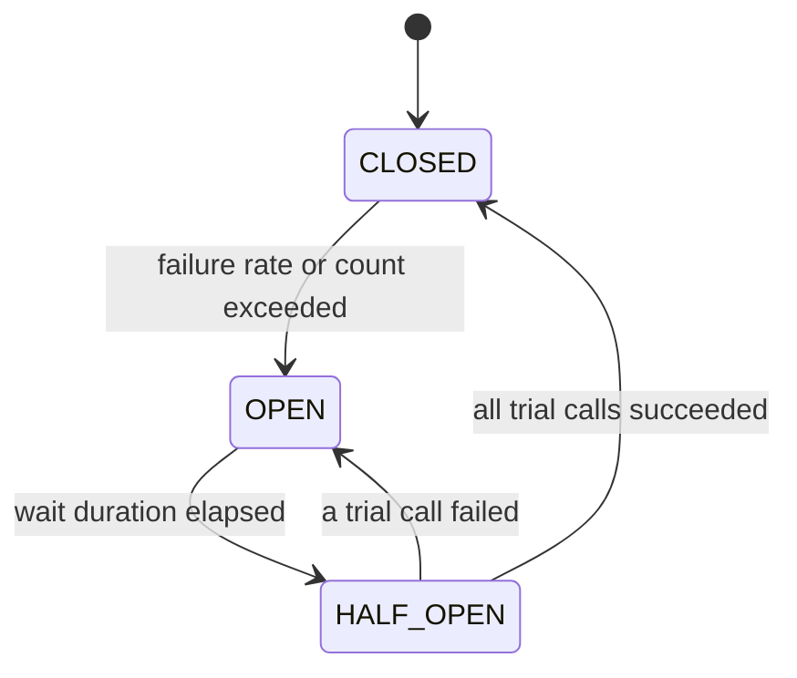

# mini-circuit-breaker

[](https://github.com/zxkgbwl/mini-circuit-breaker/actions/workflows/ci.yml)
[](LICENSE)


A small, dependency-free circuit breaker for Java. It is small enough to read in one sitting, and
it is built to show *how* a circuit breaker works: a CAS-driven state machine, a bucketed sliding
window, deterministic time-based tests, and an honest list of the trade-offs.

> **Production use:** if you need a battle-tested library, use
> [Resilience4j](https://github.com/resilience4j/resilience4j). This project is a compact,
> readable implementation of the same core idea.

## Features

- Three-state machine: `CLOSED` → `OPEN` → `HALF_OPEN`, with no background threads. State
  transitions are lock-free (compare-and-set); the only lock is a short `synchronized` block when a
  one-second window bucket is recycled.
- Trips on a failure **rate** *or* a failure **count**, evaluated over a time-based sliding window
  and only once a minimum number of calls has been seen.
- **Exception filtering**: ignore business exceptions, whitelist infrastructure exceptions, or plug
  in a predicate.
- **Fallbacks** for rejected calls and failed calls.
- **State transition listeners** that tell you what changed and *why*.
- Zero runtime dependencies (Java 17+).
- Time is injectable, so every time-dependent behaviour is tested without `Thread.sleep`.

## Quick start

```java
CircuitBreakerConfig config = CircuitBreakerConfig.builder()
        .failureRateThreshold(0.5)          // trip at 50% failures ...
        .failureThreshold(20)               // ... or 20 failures in the window
        .minimumNumberOfCalls(10)           // but only after at least 10 calls
        .slidingWindowSizeInSeconds(10)
        .waitDuration(Duration.ofSeconds(30))
        .permittedCallsInHalfOpen(3)
        .ignoreExceptions(NotFoundException.class)   // business errors never trip the breaker
        .build();

CircuitBreaker breaker = new CircuitBreaker(config);

// Returns the fallback when the call fails or the breaker is open.
String body = breaker.callWithFallback(() -> client.fetch(), error -> "default");

// Or let exceptions propagate (CallNotPermittedException when the breaker rejects the call).
String body2 = breaker.call(() -> client.fetch());
```

### Installation

The library is not on Maven Central yet. Clone the repository and install it into your local
Maven repository:

```bash
git clone https://github.com/zxkgbwl/mini-circuit-breaker.git
cd mini-circuit-breaker
mvn install
```

```xml
<dependency>
  <groupId>com.george</groupId>
  <artifactId>mini-circuit-breaker</artifactId>
  <version>0.1.0</version>
</dependency>
```

## How it works



| Transition | Reason (`TransitionReason`) |
|---|---|
| `CLOSED → OPEN` | `FAILURE_RATE_EXCEEDED` or `FAILURE_COUNT_EXCEEDED` (if both hold, the rate is reported) |
| `OPEN → HALF_OPEN` | `WAIT_DURATION_ELAPSED` |
| `HALF_OPEN → CLOSED` | `PROBES_SUCCEEDED` |
| `HALF_OPEN → OPEN` | `PROBE_FAILED` |

- **CLOSED**: calls pass through and their outcome is recorded in the sliding window.
- **OPEN**: calls are rejected immediately with `CallNotPermittedException`; the downstream is not touched.
- **HALF_OPEN**: only `permittedCallsInHalfOpen` trial calls are let through. If they all succeed the
  breaker closes; a single failure re-opens it and restarts the wait.

There is no timer thread: `OPEN → HALF_OPEN` is evaluated lazily when the next call arrives, so
`getState()` can still report `OPEN` after the wait duration has passed until a call comes in.

## Configuration

| Setting | Default | Meaning |
|---|---|---|
| `failureRateThreshold` | `0.5` | Trip when failures / calls in the window reaches this ratio (0 to 1). Note: `0.0` trips as soon as `minimumNumberOfCalls` is reached, even if every call succeeded. |
| `failureThreshold` | `5` | Trip when the number of failures in the window reaches this count. |
| `minimumNumberOfCalls` | `5` | Neither threshold is evaluated before the window holds this many calls. |
| `slidingWindowSizeInSeconds` | `5` | Only calls from the last N seconds are considered. |
| `waitDuration` | `10 s` | How long the breaker stays `OPEN` before allowing trial calls. |
| `permittedCallsInHalfOpen` | `3` | Number of trial calls in `HALF_OPEN`; all must succeed to close. |

The breaker trips when **either** threshold is reached, so set `failureThreshold` high if you only
want the rate to matter.

## Exceptions and fallbacks

Which exceptions count as failures is decided in this order:

1. `ignoreExceptions(...)`: matching exceptions (and subclasses) never count as failures.
2. `recordExceptions(...)`: if any are given, only matching exceptions can count as failures.
3. `recordFailurePredicate(...)`: a final custom check (must be side-effect free and must not throw).

| Outcome of a call | Sliding window | `HALF_OPEN` trial permit | Fallback |
|---|---|---|---|
| Success | counted as success | counts towards closing | not used |
| Failure (counted) | counted as failure | re-opens the breaker | **used** |
| Ignored exception | **not counted at all** | permit is handed back | not used, exception rethrown unchanged |
| Rejected by the breaker | not recorded | n/a | **used** (receives `CallNotPermittedException`) |

Failures hidden by a fallback are still recorded, so the breaker still trips when the downstream
is down.

## Observing state changes

```java
breaker.addListener(event ->
        log.info("{} -> {} ({})", event.getFrom(), event.getTo(), event.getReason()));

// or the bundled one-line logger
breaker.addListener(LoggingStateTransitionListener.toStdout("inventory"));
```

Listeners run synchronously on the thread that performed the transition, each transition is
reported exactly once, and an exception thrown by a listener is logged and never affects the caller.

## Demo

[`FlakyServiceDemo`](src/test/java/com/george/circuitbreaker/core/demo/FlakyServiceDemo.java) drives
a breaker through a whole life cycle against a simulated service that goes down and comes back.
Run it from your IDE or with:

```bash
mvn -q test-compile org.codehaus.mojo:exec-maven-plugin:3.5.0:java \
    -Dexec.mainClass=com.george.circuitbreaker.core.demo.FlakyServiceDemo \
    -Dexec.classpathScope=test
```

The transitions it prints:

```
[CircuitBreaker:inventory] CLOSED -> OPEN (FAILURE_RATE_EXCEEDED)
[CircuitBreaker:inventory] OPEN -> HALF_OPEN (WAIT_DURATION_ELAPSED)
[CircuitBreaker:inventory] HALF_OPEN -> OPEN (PROBE_FAILED)
[CircuitBreaker:inventory] OPEN -> HALF_OPEN (WAIT_DURATION_ELAPSED)
[CircuitBreaker:inventory] HALF_OPEN -> CLOSED (PROBES_SUCCEEDED)
```

and a summary line: `28 calls issued, 21 reached the service, 7 were rejected by the breaker.`

<details>
<summary>Full output</summary>

```
== 1. Healthy service: calls pass through ==
  call  1  sku-1      -> stock(sku-1)=42                        [state=CLOSED]
  call  2  sku-2      -> stock(sku-2)=42                        [state=CLOSED]
  call  3  sku-3      -> stock(sku-3)=42                        [state=CLOSED]
  call  4  sku-4      -> stock(sku-4)=42                        [state=CLOSED]
  call  5  sku-5      -> stock(sku-5)=42                        [state=CLOSED]

== 2. Business errors are ignored: they never trip the breaker ==
  call  6  unknown-1  -> THREW UnknownSkuException              [state=CLOSED]
  call  7  unknown-2  -> THREW UnknownSkuException              [state=CLOSED]
  call  8  unknown-3  -> THREW UnknownSkuException              [state=CLOSED]
  call  9  unknown-4  -> THREW UnknownSkuException              [state=CLOSED]
  call 10  unknown-5  -> THREW UnknownSkuException              [state=CLOSED]
  call 11  unknown-6  -> THREW UnknownSkuException              [state=CLOSED]

== 3. Outage: failures are answered by the fallback until the breaker trips ==
  call 12  sku-6      -> FALLBACK(ServiceUnavailableException)  [state=CLOSED]
  call 13  sku-7      -> FALLBACK(ServiceUnavailableException)  [state=CLOSED]
  call 14  sku-8      -> FALLBACK(ServiceUnavailableException)  [state=CLOSED]
  call 15  sku-9      -> FALLBACK(ServiceUnavailableException)  [state=CLOSED]
[CircuitBreaker:inventory] CLOSED -> OPEN (FAILURE_RATE_EXCEEDED)
  call 16  sku-10     -> FALLBACK(ServiceUnavailableException)  [state=OPEN]
  call 17  sku-11     -> FALLBACK(CallNotPermittedException)    [state=OPEN]
  call 18  sku-12     -> FALLBACK(CallNotPermittedException)    [state=OPEN]
  call 19  sku-13     -> FALLBACK(CallNotPermittedException)    [state=OPEN]

== 4. OPEN: calls are rejected without touching the service ==
  call 20  sku-14     -> FALLBACK(CallNotPermittedException)    [state=OPEN]
  call 21  sku-15     -> FALLBACK(CallNotPermittedException)    [state=OPEN]
  call 22  sku-16     -> FALLBACK(CallNotPermittedException)    [state=OPEN]
  call 23  sku-17     -> FALLBACK(CallNotPermittedException)    [state=OPEN]
  -> calls that reached the service during this phase: 0

== 5. After the wait duration the first trial call still fails: back to OPEN ==
[CircuitBreaker:inventory] OPEN -> HALF_OPEN (WAIT_DURATION_ELAPSED)
[CircuitBreaker:inventory] HALF_OPEN -> OPEN (PROBE_FAILED)
  call 24  sku-18     -> FALLBACK(ServiceUnavailableException)  [state=OPEN]

== 6. The service recovers: trial calls succeed and the breaker closes ==
[CircuitBreaker:inventory] OPEN -> HALF_OPEN (WAIT_DURATION_ELAPSED)
  call 25  sku-19     -> stock(sku-19)=42                       [state=HALF_OPEN]
  call 26  sku-20     -> stock(sku-20)=42                       [state=HALF_OPEN]
[CircuitBreaker:inventory] HALF_OPEN -> CLOSED (PROBES_SUCCEEDED)
  call 27  sku-21     -> stock(sku-21)=42                       [state=CLOSED]
  call 28  sku-22     -> stock(sku-22)=42                       [state=CLOSED]

Summary: 28 calls issued, 21 reached the service, 7 were rejected by the breaker.
```

</details>

## Design notes

**State machine.** The state lives in an `AtomicReference`. Every transition goes through a single
`transition(from, to, reason)` method that does a compare-and-set and publishes the event only if
it won, so each transition happens, and is reported, exactly once. Under 100 concurrent failing
calls, exactly one `CLOSED → OPEN` event is emitted (covered by a test).

**Sliding window.** A ring of `N` one-second buckets, indexed by `second mod N`. Each bucket is
tagged with the second it belongs to and counts with `LongAdder`. The first write in a new second
lazily clears and re-tags the bucket (a short `synchronized` block, at most once per bucket and
second), so there is no cleanup thread. Snapshots take no lock: they
read a bucket's second, then its counters, then the second again, and skip the bucket if it
changed in between (an optimistic, seqlock-style read). Memory and snapshot cost are `O(N)`,
independent of traffic.

**Injected clock.** The breaker and the window read time from a `LongSupplier`, so tests advance
a fake clock instead of sleeping. This also made edge cases easy to pin down: the clock starting
at second 0, a negative `System.nanoTime()`, and exact window boundaries.

**Ordering details that matter.** Most of the subtle bugs in a breaker are about ordering:

- `openedAt` is written *before* the CAS to `OPEN`, so no thread sees `OPEN` with a stale timestamp.
- The window is reset *before* the CAS to `CLOSED`, so a failure right after closing cannot be
  judged against pre-trip data and re-open the breaker at once.
- The half-open success counter is compared with `==`, not `>=`, so exactly one thread performs the
  `HALF_OPEN → CLOSED` transition.
- An ignored exception hands its trial permit back; otherwise ignored calls would use up the
  permits and leave the breaker stuck in `HALF_OPEN`.
- Half-open bookkeeping is initialised after the CAS but *before* listeners are notified, so a
  listener never sees a half-open breaker with stale counters.

## Known limitations

These are deliberate trade-offs of a small implementation, not oversights:

- **Half-open start-up race.** The trial counters are set just after the `OPEN → HALF_OPEN` CAS, so
  another thread arriving in that instant can be rejected. This race can only under-admit trial
  calls; it never lets more than the configured number through.
- **Late results.** A call that started while `CLOSED` but finishes during `HALF_OPEN` is counted
  as a trial result.
- **Permit hand-back across cycles.** If the breaker completes a full `HALF_OPEN → OPEN → HALF_OPEN`
  cycle while an ignored call is in flight, the permit it hands back lands in the new cycle.
- **Approximate statistics during bucket rotation.** A write racing with a rotation can be attributed
  to the new second, and a snapshot racing with it can skip the bucket.
- **Listener delivery.** Listeners run synchronously on the calling thread, and delivery order across
  threads is not guaranteed to match transition order.
- **Scope.** Synchronous `Supplier` calls only (no checked exceptions, no async), in memory, single
  JVM, no metrics. Rejections create an exception with a stack trace.

The first three disappear if the state, counters and a generation number are kept in one immutable
object that is replaced with a single CAS, which is what Resilience4j does. See the roadmap.

## Testing

```bash
mvn clean verify
```

- Time-dependent behaviour is tested with a fake clock; the unit tests do not sleep.
- Concurrency tests check that half-open trial permits never exceed the limit, that a burst of
  failures trips the breaker exactly once, and that the window loses no counts under 8 writer threads.
- Coverage (JaCoCo): **96%** of instructions and **92%** of branches. The report is written to
  `target/site/jacoco/index.html`.

## Compared with Resilience4j

| | mini-circuit-breaker | Resilience4j |
|---|---|---|
| Goal | Small and readable | Production library |
| Window | Time-based | Count-based and time-based |
| Slow-call detection | No | Yes |
| Async / `CompletionStage` | No | Yes |
| Metrics, Spring Boot integration | No | Yes |
| Other resilience patterns | No | Retry, bulkhead, rate limiter, ... |
| State kept as | Several atomics | One immutable state object |

## Roadmap

- Decorators (`run`, `decorateSupplier`, ...), checked-exception suppliers, a breaker registry
- `CompletionStage` support (record the outcome when the future completes)
- Spring Boot starter with an annotation and configuration properties
- Metrics hooks (success / failure / rejected counts)
- Immutable state snapshot with a single CAS to remove the races listed above
- Optional stack-trace suppression for `CallNotPermittedException`
- JMH benchmarks

## Related

- [distributed-rate-limiter](https://github.com/zxkgbwl/distributed-rate-limiter): another small distributed-systems building block.

## License

[MIT](LICENSE)
